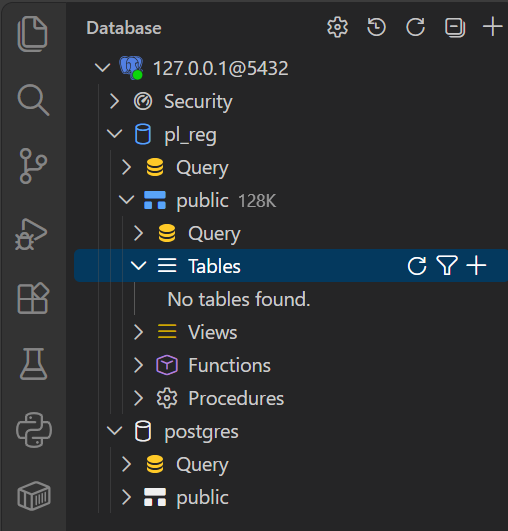
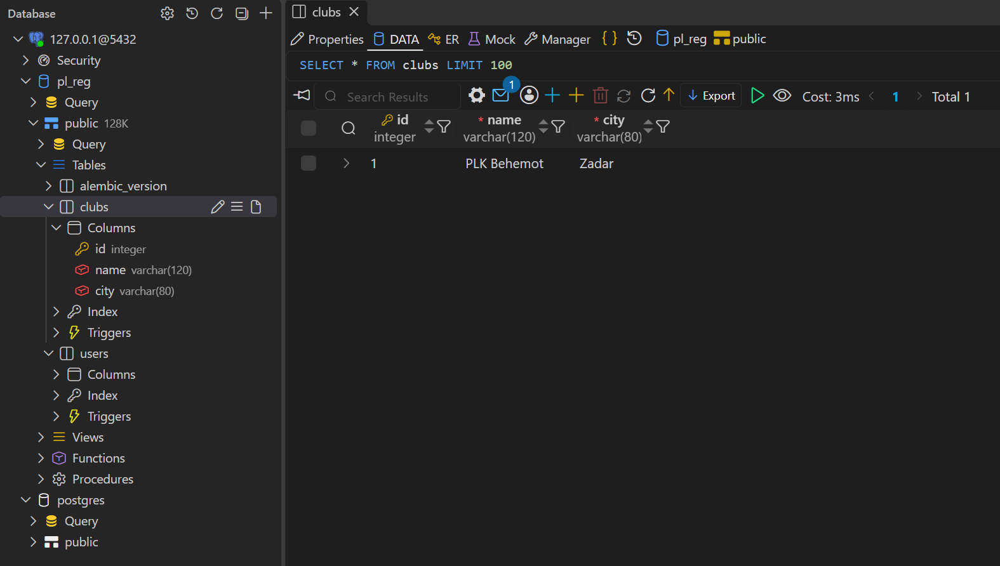
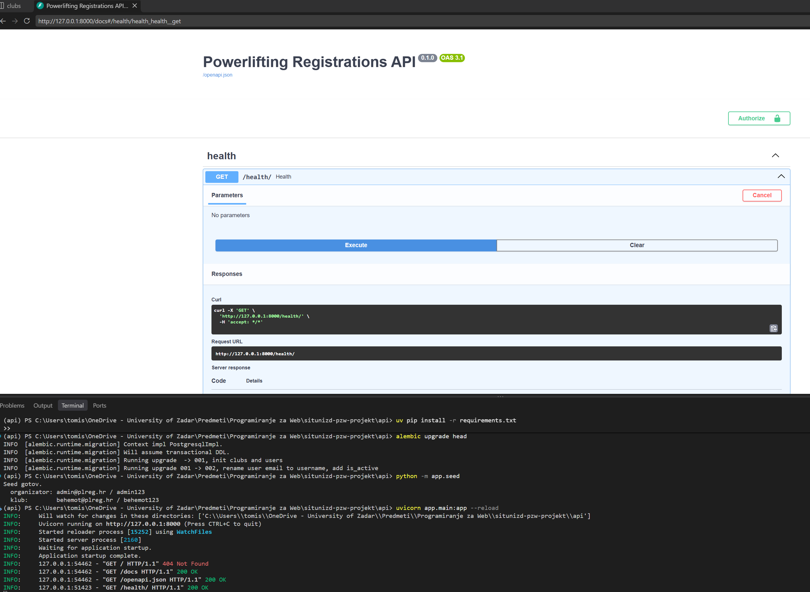
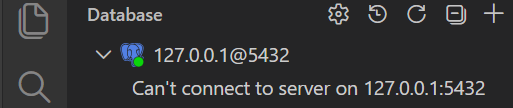

# Programiranje za web - prelazak na novo predavanje

18. listopada 2026. · doc. dr. sc. Tomislav Petković

## Uvod

Svako predavanje ima svoj tag u repozitoriju projekta: `predavanje-01`, `predavanje-02` i tako dalje. Kod se između dva taga mijenja, a s njim i shema baze, popis paketa i konfiguracija. Zbog toga okruženje iz prethodnog predavanja može biti nedostatno za rad na trenutnom predavanju.

Ova vježba prolazi cijeli prelazak s jednog predavanja na drugo, korak po korak. Iza svakog koraka stoji **provjera**: naredba i ispis koji morate vidjeti prije nego krenete dalje. Ako ispis nije isti, ne nastavljajte; pogledajte odjeljak *Česti problemi* na kraju.

Primjeri ispisa u nastavku su za prelazak na `predavanje-03`. Za svako sljedeće predavanje postupak je isti, a razlikuju se broj migracija, sadržaj baze i rute koje je potrebno provjeriti.

### Dva terminala

U VS Code-u otvorite mapu repozitorija (*File → Open Folder*) i u njoj dva terminala (gumb **+** u panelu terminala):

| Terminal | Mapa | Za što |
| --- | --- | --- |
| prvi | korijen repozitorija | `git`, `docker compose` |
| drugi | `api` | virtualno okruženje, `alembic`, `python -m app.seed`, `uvicorn` |

Naredbe `docker compose` traže datoteku `docker-compose.yml`, koja stoji u korijenu. Pokrenute iz mape `api` javljaju `no configuration file provided: not found`.

## 0. Kraj prethodnog predavanja

Ako ste prošli put završili prema koraku 3 ove vježbe, baza je već obrisana i ovaj korak preskočite. Inače, u prvom terminalu:

```bash
docker compose down -v
```

Zašto se baza briše opisuje korak 2b.

## 1. Kod novog predavanja

### 1a. Čisto radno stablo

```bash
git status
```

Očekivani ispis završava retkom:

```text
nothing to commit, working tree clean
```

Ako `git status` navodi izmijenjene datoteke (`modified:`) ili nove datoteke (`Untracked files:`), radno stablo nije čisto. Izmjene obrišite:

```bash
git restore .       # izmijenjene datoteke
git clean -fd       # nove datoteke
```

Ponovite `git status` dok ne dobijete `working tree clean`. Tko izmjene želi sačuvati, može ih prije brisanja spremiti na svoju granu.

### 1b. Prelazak na tag

```bash
git checkout predavanje-03
git status
```

Očekivani ispis zadnje naredbe:

```text
HEAD detached at predavanje-03
nothing to commit, working tree clean
```

*Detached HEAD* znači da niste ni na jednoj grani, nego na točno određenom *commitu*. Za praćenje predavanja to je ispravno stanje.

### 1c. Što checkout ne mijenja

Neke datoteke git namjerno ne prati. One ostaju na disku kakve jesu, bez obzira na tag:

```bash
git status --ignored --short
```

```text
!! .env
!! api/.venv/
!! api/app/__pycache__/
...
```

To su upravo `.env` s konfiguracijom i `api/.venv` s instaliranim paketima. Kod je novi, a one su iz prošlog tjedna. Zbog toga je potrebno provjeriti korake 2a i 2c.

## 2. Pokretanje prema README-u

Otvorite `README.md` novog predavanja i pronađite odjeljak *Pokretanje*. Koraci u nastavku slijede ga redom, uz provjeru iza svakoga.

### 2a. Konfiguracija

Predložak `.env.example` mijenja se između predavanja, pa se `.env` pri svakom prelasku kopira iznova. U prvom terminalu:

```bash
cp .env.example .env        # PowerShell: Copy-Item .env.example .env
```

Naredba prepisuje staru `.env`. Ako kopiranje javi pogrešku, obrišite staru `.env` i ponovite naredbu.

### 2b. Baza

**Prvo provjerite da nijedna baza ne postoji.** Pokrenite Docker Desktop i pričekajte *Engine running*. U prvom terminalu:

```bash
docker ps -a
docker volume ls
```

`docker ps -a` prikazuje sve kontejnere na računalu: one koji rade, one koji su ugašeni i one iz drugih projekata. Obje naredbe smiju ispisati samo zaglavlje:

```text
CONTAINER ID   IMAGE     COMMAND   CREATED   STATUS    PORTS     NAMES
DRIVER    VOLUME NAME
```

Primjer ispisa kad još radi baza iz uputa za pripremu okruženja (`pzw-provjera`), a postoji i baza ovog projekta:

```text
CONTAINER ID   IMAGE         COMMAND                  CREATED         STATUS        PORTS                                         NAMES
bb50f3845718   postgres:16   "docker-entrypoint.s…"   1 second ago    Created                                                     situnizd-pzw-projekt-db-1
4df8d4a6dce7   postgres:17   "docker-entrypoint.s…"   2 seconds ago   Up 1 second   0.0.0.0:5432->5432/tcp, [::]:5432->5432/tcp   pzw-provjera-db-1

DRIVER    VOLUME NAME
local     613f4956b73f98316fc6b44486aef6a4d393870a8c030b16a6087fc59953a570
local     situnizd-pzw-projekt_pgdata
```

Oba kontejnera traže isti port 5432. Dok `pzw-provjera-db-1` radi, baza ovog projekta ne može se pokrenuti i ostaje u stanju `Created`, a `docker compose up` javlja `Bind for 0.0.0.0:5432 failed: port is already allocated`.

**Obrišite svaki kontejner** po imenu iz stupca `NAMES`:

```bash
docker rm -f -v pzw-provjera-db-1
docker rm -f -v situnizd-pzw-projekt-db-1
```

Zastavica `-f` kontejner koji radi prvo zaustavi, pa ga obriše. Zastavica `-v` uz kontejner obriše i njegov volumen bez imena; takav je volumen s nazivom od dugog niza znakova u gornjem ispisu, koji je stvorio `pzw-provjera`. Volumen s imenom ostaje, pa ga **obrišite** po imenu iz stupca `VOLUME NAME`:

```bash
docker volume rm situnizd-pzw-projekt_pgdata
```

Volumen se ne može obrisati dok postoji kontejner koji ga koristi, pa se kontejneri brišu prvi. Ako Docker koristite i za druge kolegije, brišite samo kontejnere i volumene ovog kolegija.

Ponovite `docker ps -a` i `docker volume ls` dok obje ne ispišu samo zaglavlje.

Baza se briše zato što pamti stanje starog koda: tablice, stupce i broj zadnje migracije. Novo predavanje može tablicu preimenovati ili joj dodati stupac, a stari podatci tada ne odgovaraju novom kodu. Najmanje problema stvara prazna baza koju gradi kod novog predavanja.

**Pokretanje baze:**

```bash
docker compose up -d db
docker compose ps
```

U ispisu `up` mora pisati da je volumen stvoren (`Created`), a ne zatečen:

```text
 Volume situnizd-pzw-projekt_pgdata Created
 Network situnizd-pzw-projekt_default Created
 Container situnizd-pzw-projekt-db-1 Started
```

Druga naredba prikazuje red s `Up` i `0.0.0.0:5432->5432/tcp`:

```text
NAME                        IMAGE         COMMAND                  SERVICE   CREATED         STATUS         PORTS
situnizd-pzw-projekt-db-1   postgres:16   "docker-entrypoint.s…"   db        5 seconds ago   Up 4 seconds   0.0.0.0:5432->5432/tcp, [::]:5432->5432/tcp
```

**Provjera da je baza prazna, naredbom.** Klijent `psql` već postoji u kontejneru s bazom:

```bash
docker compose exec db psql -U pl_user -d pl_reg -c "\dt"
```

```text
Did not find any relations.
```

Baza `pl_reg` postoji, ali u njoj nema nijedne tablice.

**Provjera da je baza prazna, ekstenzijom Database.** Na lijevoj traci VS Code-a otvorite *Database* i dodajte novu vezu tipa PostgreSQL:

| Podatak | Vrijednost |
| --- | --- |
| Host | `127.0.0.1` |
| Port | `5432` |
| Username | `pl_user` |
| Password | `pl_pass` |
| Database | `pl_reg` |

Vrijednosti su iste kao u datoteci `docker-compose.yml` i u varijabli `DATABASE_URL` u `.env`. Veza ostaje zapamćena, pa je sljedeći tjedan ne treba ponovno upisivati.

Nakon spajanja raširite `127.0.0.1@5432 → pl_reg → public → Tables`. Ondje piše *No tables found.*



### 2c. Virtualno okruženje i paketi

U drugom terminalu, u mapi `api`:

```bash
cd api
```

Ako mapa `.venv` ne postoji, napravite je s `uv venv`. Ako postoji, ne pokrećite `uv venv` ponovno, jer javlja `A virtual environment already exists at: .venv`.

Aktivacija:

```bash
.venv\Scripts\Activate.ps1      # Windows (PowerShell)
source .venv/bin/activate       # macOS / Linux
```

**Provjera da ste u virtualnom okruženju.** Ispred prompta mora pisati `(api)` ili `(.venv)`. Sigurnija provjera je pitati Python gdje je:

```bash
python -c "import sys; print(sys.prefix)"
```

```text
...\situnizd-pzw-projekt\api\.venv
```

Ako ispis ne završava s `api\.venv` (na macOS-u i Linuxu `api/.venv`), paketi bi se instalirali u sistemski Python. Aktivirajte okruženje i ponovite provjeru.

**Instalacija paketa.** Popis u `requirements.txt` mijenja se između predavanja, pa se ova naredba pokreće pri **svakom** prelasku, i kad `.venv` već postoji:

```bash
uv pip install -r requirements.txt
```

Paketi koji su već instalirani se preskaču, a novi se dodaju. Primjer pri prelasku s predavanja 2 na predavanje 3:

```text
Resolved 39 packages in 1.49s
Installed 11 packages in 466ms
 + httpx==0.28.1
 + pyjwt==2.15.1
 + pytest==9.1.1
 ...
```

Bez ovoga koraka aplikacija pada pri pokretanju s `ModuleNotFoundError: No module named 'jwt'`.

### 2d. Migracije i početni podatci

U drugom terminalu, s aktivnim virtualnim okruženjem:

```bash
alembic upgrade head
```

```text
INFO  [alembic.runtime.migration] Context impl PostgresqlImpl.
INFO  [alembic.runtime.migration] Will assume transactional DDL.
INFO  [alembic.runtime.migration] Running upgrade  -> 001, init clubs and users
INFO  [alembic.runtime.migration] Running upgrade 001 -> 002, rename user email to username, add is_active
```

Svaki redak `Running upgrade` je jedna migracija iz mape `api/alembic/versions`. U praznoj bazi primjenjuju se sve, od prve. Na kojoj je migraciji baza sada:

```bash
alembic current
```

```text
002 (head)
```

`(head)` znači da je baza na zadnjoj migraciji koju kod poznaje.

Početni podatci:

```bash
python -m app.seed
```

```text
Seed gotov.
  organizator: admin@plreg.hr / admin123
  klub:        behemot@plreg.hr / behemot123
```

**Provjera sadržaja baze, naredbom.** U prvom terminalu:

```bash
docker compose exec db psql -U pl_user -d pl_reg -c "\dt"
```

```text
             List of relations
 Schema |      Name       | Type  |  Owner
--------+-----------------+-------+---------
 public | alembic_version | table | pl_user
 public | clubs           | table | pl_user
 public | users           | table | pl_user
(3 rows)
```

Tablicu `alembic_version` stvara Alembic i u njoj pamti broj zadnje primijenjene migracije. Ostale tablice odgovaraju modelima u `api/app/models`.

```bash
docker compose exec db psql -U pl_user -d pl_reg -c "SELECT id, username, role, club_id, is_active FROM users;"
```

```text
 id |     username     | role  | club_id | is_active
----+------------------+-------+---------+-----------
  1 | admin@plreg.hr   | admin |         | t
  2 | behemot@plreg.hr | club  |       1 | t
(2 rows)
```

Stupac `password_hash` je namjerno izostavljen iz upita; lozinke su u bazi spremljene kao *hash*, ne kao tekst.

**Provjera sadržaja baze, ekstenzijom Database.** Osvježite popis tablica (ikona osvježavanja pokraj *Tables*). Pod *Tables* su sada `alembic_version`, `clubs` i `users`. Klik na tablicu otvara njezine retke; na slici je tablica `clubs` s jednim klubom.



Za predavanje 3 sadržaj baze je:

| Tablica | Redaka | Sadržaj |
| --- | --- | --- |
| `alembic_version` | 1 | `002` |
| `clubs` | 1 | PLK Behemot, Zadar |
| `users` | 2 | organizator `admin@plreg.hr`, račun kluba `behemot@plreg.hr` |

### 2e. Pokretanje aplikacije

U drugom terminalu:

```bash
uvicorn app.main:app --reload
```

Ispis završava retkom:

```text
INFO:     Application startup complete.
```

Terminal ostavite otvoren dok aplikacija radi. U pregledniku otvorite:

| Adresa | Očekivano |
| --- | --- |
| <http://127.0.0.1:8000/health> | `{"status":"ok"}` |
| <http://127.0.0.1:8000/docs> | Swagger UI s popisom ruta |

U Swaggeru otvorite rutu `GET /health/`, pritisnite *Try it out*, zatim *Execute*. Ispod se prikazuju statusni kod `200` i tijelo odgovora `{"status": "ok"}`.



U terminalu s aplikacijom svaki zahtjev ostavlja redak sa statusnim kodom:

```text
INFO:     127.0.0.1:50852 - "GET /health/ HTTP/1.1" 200 OK
```

## 3. Gašenje i provjera da je sve prazno

Zaustavite aplikaciju s **Ctrl+C** u drugom terminalu i izađite iz virtualnog okruženja:

```bash
deactivate
```

U prvom terminalu ugasite bazu i obrišite njezin volumen:

```bash
docker compose down -v
```

```text
 Container situnizd-pzw-projekt-db-1 Removed
 Volume situnizd-pzw-projekt_pgdata Removed
 Network situnizd-pzw-projekt_default Removed
```

Zastavica `-v` briše i volumen. Bez nje bi `down` uklonio kontejner, a podatci bi ostali i sljedeći tjedan dočekali kod novog predavanja. Sve što ste unijeli kroz Swagger time nestaje; početne podatke vraća `python -m app.seed`.

**Provjera naredbama:**

```bash
docker ps -a
docker volume ls
git status
```

Prve dvije ispisuju samo zaglavlje, kao u koraku 2b. Treća ispisuje `working tree clean`: vježba nije mijenjala kod.

**Provjera ekstenzijom Database.** Pokušaj spajanja na vezu sada javlja *Can't connect to server on 127.0.0.1:5432* jer baza više ne radi.



Okruženje je spremno za sljedeće predavanje, koje počinje korakom 1.

## Sažetak naredbi

Prvi terminal, korijen repozitorija:

```bash
git status                                  # working tree clean
git checkout predavanje-NN
cp .env.example .env                        # PowerShell: Copy-Item .env.example .env
docker ps -a                                # samo zaglavlje; inače docker rm -f -v
docker volume ls                            # samo zaglavlje; inače docker volume rm
docker compose up -d db
docker compose exec db psql -U pl_user -d pl_reg -c "\dt"
```

Drugi terminal, mapa `api`:

```bash
.venv\Scripts\Activate.ps1                  # macOS / Linux: source .venv/bin/activate
python -c "import sys; print(sys.prefix)"   # ...\api\.venv
uv pip install -r requirements.txt
alembic upgrade head
alembic current                             # NNN (head)
python -m app.seed
uvicorn app.main:app --reload
```

Na kraju: Ctrl+C, `deactivate`, pa u prvom terminalu `docker compose down -v`.

## Česti problemi

Problemi s instalacijom alata opisani su u uputama *Programiranje za web - priprema razvojnog okruženja*. Ovdje su oni koji nastaju pri prelasku između predavanja.

| Simptom | Uzrok | Rješenje |
| --- | --- | --- |
| `ModuleNotFoundError: No module named '...'` pri pokretanju `uvicorn` ili `alembic` | Novo predavanje traži paket koji nije instaliran | Korak 2c: aktivirajte okruženje i pokrenite `uv pip install -r requirements.txt` |
| `A virtual environment already exists at: .venv` | `uv venv` pokrenut u mapi koja već ima okruženje | Preskočite `uv venv`; za potpuno novo okruženje `uv venv --clear`, pa ponovno instalirajte pakete |
| `Can't locate revision identified by '...'` pri `alembic upgrade head` | Baza je na migraciji iz drugog predavanja, koju ovaj kod ne poznaje | `docker compose down -v`, pa korak 2b i 2d ispočetka |
| `alembic upgrade head` ne ispisuje nijedan `Running upgrade`, a `\dt` prikazuje tablice | Baza iz prošlog predavanja nije obrisana | Isto kao redak iznad |
| `no configuration file provided: not found` | `docker compose` pokrenut iz mape `api` | Naredbu pokrenite u prvom terminalu, u korijenu repozitorija |
| `Bind for 0.0.0.0:5432 failed: port is already allocated` | Port 5432 drži drugi kontejner, npr. iz uputa za pripremu okruženja, ili lokalno instaliran PostgreSQL | Korak 2b: `docker ps -a`, pa `docker rm -f -v` za svaki kontejner; ako kontejnera nema, ugasite lokalni PostgreSQL |
| `Field required` za `DATABASE_URL` ili drugu varijablu pri pokretanju | `.env` ne postoji ili u njoj nedostaje varijabla | Korak 2a |
| `error: pathspec 'predavanje-NN' did not match any file(s) known to git` | Lokalni repozitorij ne zna za novi tag | `git fetch --tags`, pa ponovite `git checkout` |
| `Your local changes ... would be overwritten by checkout` | Radno stablo nije čisto | Korak 1a |
| `ConnectionRefusedError` ili `Connection refused` pri `alembic` ili `python -m app.seed` | Baza nije pokrenuta | `docker compose ps`; ako nema reda s `Up`, `docker compose up -d db` |